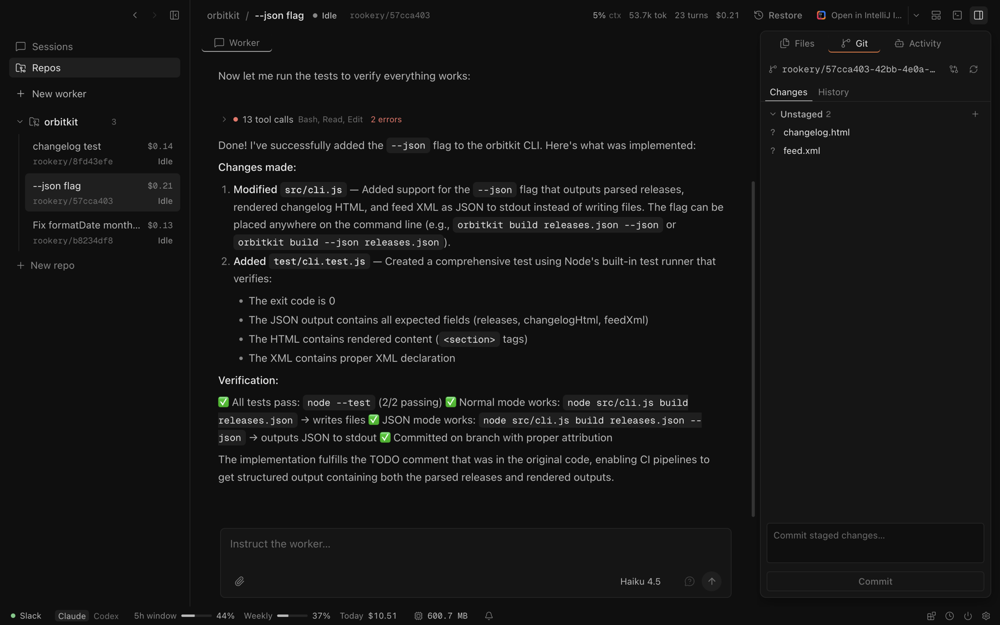
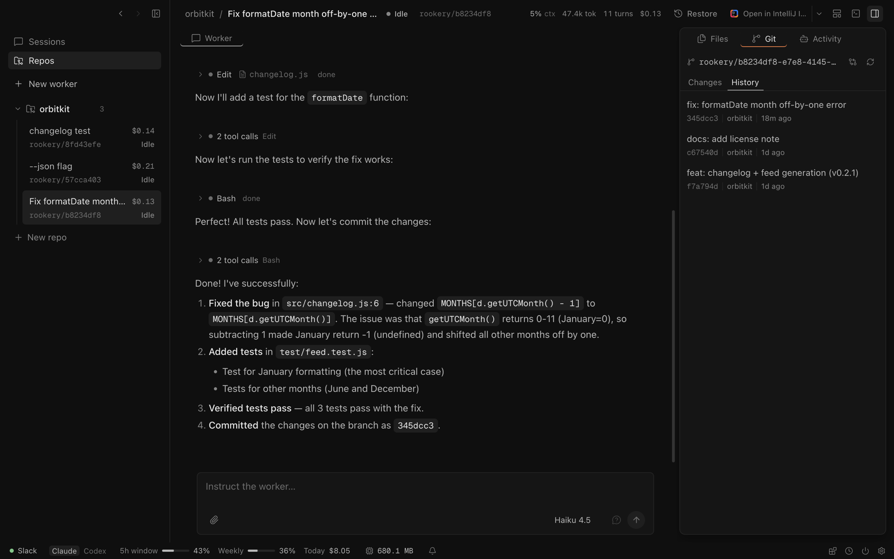
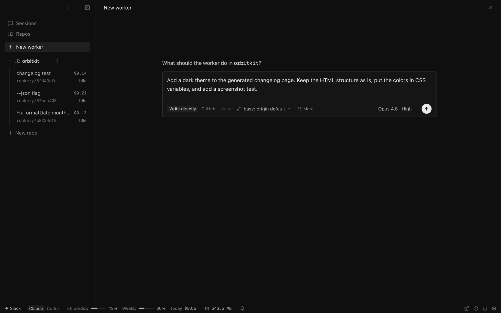
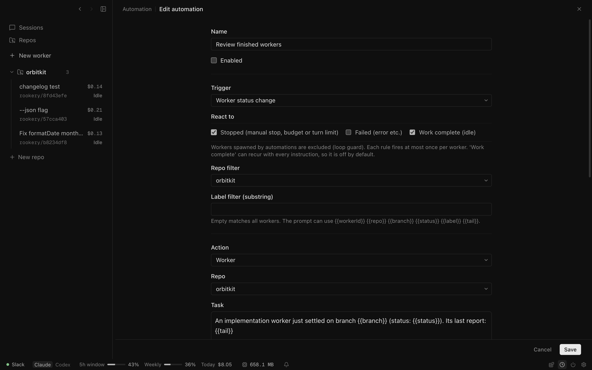
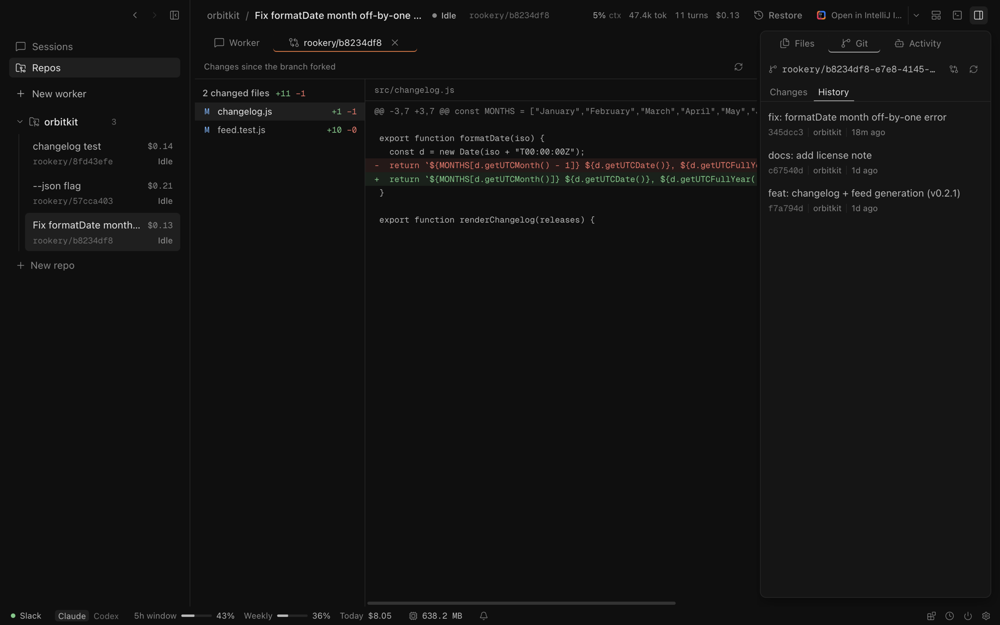

# rookery

**An open-source agentic development environment: a resident AI orchestrator with memory, a fleet of coding workers isolated in git worktrees, and mission control to run it all — on your machine.**

A long-lived daemon hosts **master agent** sessions that register your repos, remember project context, and spawn **workers** that code in parallel — each in its own git worktree and branch, on the AI backend you choose (**Claude or Codex**). The desktop app, CLI, and Slack are thin clients: close them anytime, the daemon keeps working.

<p align="center">
  
</p>

<table>
  <tr>
    <td width="50%"></td>
    <td width="50%"></td>
  </tr>
  <tr>
    <td align="center"><sub><b>The fleet</b> — every worker has its own transcript, diff, checkpoints, terminal, and cost.</sub></td>
    <td align="center"><sub><b>New worker</b> — describe the task, or start straight from a GitHub issue or Linear ticket.</sub></td>
  </tr>
  <tr>
    <td width="50%"></td>
    <td width="50%"></td>
  </tr>
  <tr>
    <td align="center"><sub><b>Automation</b> — cron / interval / Slack / worker-settled triggers, with per-rule model, backend, and budget.</sub></td>
    <td align="center"><sub><b>Branch diff</b> — review everything a worker changed since its branch forked.</sub></td>
  </tr>
</table>

A 90-second demo of a real run (recorded on an earlier version of the app): real workers, real commits, real automation.

https://github.com/user-attachments/assets/38face67-d553-4c51-9741-b0942ca337cd

## Why rookery

- **Always-on, not tab-bound.** The daemon owns sessions, workers, memory, and automations. Clients attach and detach; overnight runs survive; conversations restore on reconnect — including tool calls and reasoning.
- **A real fleet, safely parallel.** Every worker gets its own worktree + branch (`rookery/<id>`). Nothing touches your checkout; you review diffs and tell workers to commit, push, and open PRs themselves.
- **Two brains, one control plane.** Masters, workers, automations, and Slack threads each pick their backend — Claude or Codex — with per-surface model, effort, and **Standard/Fast speed** controls, live model catalogs, and even **cross-provider fork** (continue a Claude conversation on Codex, or vice versa).
- **Steer, don't restart.** A message to a busy worker lands in the turn it is already running (Codex `turn/steer`, Claude streaming input), so you can redirect work mid-flight without losing it. Stop a single runaway background task without stopping the worker (Claude workers).
- **A fleet that reacts, not just obeys.** Automations fire on schedules (cron / every N minutes), Slack messages, or **when a worker settles** — so "implementation worker finished → spawn a reviewer on its branch" is a rule, not a ritual.
- **Honest signals.** Worker states are truthful: `idle` means *all assigned work is done* — a worker waiting on a background shell shows `background`, and completion notifications fire only at the real finish line. The **attention bell** ranks what needs you *now*: blocked questions first, failures second, unreviewed results third.
- **Drives and is driven.** Talk to it from Slack (thread = session), or expose the fleet as an **MCP server** and drive rookery from Claude Code, Cursor, or Codex — code never leaves your machine.
- **Guardrails for unattended work.** Lifetime USD budgets per worker/automation, turn caps, prompt-injection fencing for untrusted input (Slack text, worker output), and fail-closed defaults everywhere.

## What you can do

### Mission control (desktop)

An IDE-style workbench (think VS Code or Zed) for the whole fleet:

- **Sessions and the live fleet** in one sidebar — per-repo workers with status, branch, and cost — plus a status bar for daemon/Slack state, Claude and Codex usage, memory, and one attention bell that ranks what needs you now.
- **Streaming conversations** with tool calls, reasoning, and metrics; attach **images** (pick, drop, or paste) to masters, workers, and Side questions.
- **A dockable workspace per conversation**: file explorer, Git panel, Monaco editor and diff, and a terminal in each worktree. Panels resize and hide sensibly on small windows and come back at the size you chose.
- **Per-worker review**: transcript, checkpoints you can restore, the **whole-branch diff** since the worker forked, and its own terminal.
- **New worker page**: describe the task in one box, or start **straight from a GitHub issue or Linear ticket**; drafts are kept per repo.
- One model menu per composer for model, effort, permission mode, and speed; keyboard shortcuts (⌘B, ⌘N, ⌘,, ⌘[ / ⌘]); Korean and English UI.

### Capability Center

Bring your own skills, instructions, and MCP servers to every agent — once. Register a capability pack (or use **Catalog → Add MCP / Import Skill / Build MCP pack**), review and trust its exact file digest, and assign it to all of rookery, a repository, a session, or a single worker, for master, worker, or Side agents. More specific assignments override broader ones.

Trusted packs apply to **both Claude and Codex** without touching your `~/.claude`, `~/.codex/config.toml`, or repository provider files. Secret values are write-only: they reach only the provider process that needs them and are never shown back in the UI or written to generated config. **Effective** shows exactly what a given master or worker gets (or would get, as a preview before you start one); a live worker can reload new capabilities without losing its conversation or worktree. Repositories can also check in a shared index at `.rookery/capabilities.json` — discovered automatically, never trusted or enabled automatically.

Start with the example pack in [`docs/examples/capability-pack`](docs/examples/capability-pack/): import it in Capability Center → Catalog, review and trust the digest, assign it, and check the result in Effective.

### The fleet

The master routes tasks across your registered repos, spawns workers, watches them, steers them mid-flight, and gets woken when they finish. A follow-up to a busy worker is folded into the turn it is running; otherwise it continues the same worker session with full context. Interrupt a turn, stop a single background task (Claude workers), recover a stuck worker in place, or stop it for good — the worktree stays until you discard it. Optional lifetime USD budgets stop a worker that overspends. After a daemon restart, workers rehydrate from disk — diffs, stop, and resume keep working.

### Automation

Rules = **trigger × action**, built in the Automation page:

| Triggers | Actions |
|---|---|
| Cron schedule · every N minutes · Slack message match · **worker settled** (idle / stopped / failure) | Run a master turn · spawn a worker |

Template variables (`{{message}}`, `{{branch}}`, `{{tail}}`, …) carry the trigger's context into the prompt — always fenced as untrusted input. Failures surface in the attention bell.

### Slack

A thread is a session: mention `@rookery` or use the Assistant panel, and the same thread stays the same conversation across daemon restarts. Tool calls render as live plan cards; worker activity can be relayed to a channel. Access is allowlist-gated and fail-closed. See [Slack setup](#slack-setup) below.

### Use rookery from other agents (External MCP)

Expose the fleet as an MCP server (**Settings → General → External MCP**, off by default):

```bash
claude mcp add rookery --transport http "http://127.0.0.1:8787/mcp-ext/<token>"
```

- **Read-only**: list workers, inspect status/transcripts/diffs.
- **Full control**: also spawn, steer, and stop workers.

> ⚠️ Full control lets an external agent drive workers that run with `bypassPermissions`. Enable only for clients you trust; rotate the token from Settings if a URL leaks.

## Install

- **macOS (Apple Silicon):** [⬇ `.dmg`](https://github.com/CChuYong/rookery/releases/latest/download/rookery-arm64.dmg)
- **Linux (x86_64):** [⬇ `.AppImage`](https://github.com/CChuYong/rookery/releases/latest/download/rookery-x86_64.AppImage)
- **Windows (x64):** [⬇ `.exe` installer](https://github.com/CChuYong/rookery/releases/latest/download/rookery-x64-setup.exe)

## Quick start

**Desktop app — no prerequisites.** Download it above, launch, done: the app bundles its own Node runtime and starts and manages the daemon for you. A first-run checklist walks you through the rest — connect Claude (paste an API key in Settings, or an existing `claude login` is picked up automatically), pick a work folder, start a session, and spawn your first worker. Codex is optional — authenticate the `codex` CLI or set an in-app key to unlock the second backend.

**Headless / CLI** — requires **Node.js ≥ 22**:

```bash
export ANTHROPIC_API_KEY=sk-ant-...
node dist/index.js daemon      # run the daemon in the foreground
node dist/index.js             # or use the CLI (auto-starts a daemon if none is running)
```

Build from source (Node.js ≥ 22):

```bash
npm install && npm run build   # daemon/CLI → dist/
npm -w apps/desktop run dev    # desktop app (dev), run from a Node 22 shell
```

Architecture and contributor docs live in [`docs/`](docs/README.md) (start there) and `AGENTS.md`.

## Backends & authentication

Both backends reach the same orchestration and tools; pick per session/worker/automation/Slack thread (or `--provider claude|codex` on the CLI).

- **Claude** — in-app API key (**Settings → Anthropic API key**) or `ANTHROPIC_API_KEY`; falls back to Claude Code OAuth (`claude login`). All permission modes supported.
- **Codex** — in-app key (**Settings → Codex API key**) or `codex login`; requires Codex CLI **0.169.0 or newer**. Model/effort pickers are driven by the live model catalog. Codex **masters** are `bypassPermissions`-only (workers are unaffected).

## Data handling

**What leaves your machine:** prompts and responses, referenced repository code/diffs/terminal output, and (if connected) Slack message text — sent to the LLM provider of the surface that runs them. Claude surfaces talk to Anthropic; Codex surfaces route the same data to OpenAI. The provider is always explicit and selectable per surface — review it before pointing a second vendor at sensitive code.

**What stays local:** everything else. Conversation history, memory, integration tokens, logs, and worker worktrees live under `~/.rookery` (hardened to `0700`/`0600` on boot). The desktop app shows a one-time data-transmission consent screen on first run.

## Security note

The master and workers run with `permissionMode: "bypassPermissions"` (a headless daemon has no TTY for approval prompts): they auto-approve tool use, including bash and file writes, in their working directories. Worktree isolation contains workers to their own copies, and USD budgets/turn caps bound runaway cost — but run rookery only in trusted environments and paths.

## Slack setup

1. Create an app at https://api.slack.com/apps.
2. Enable **Socket Mode** → issue an App-Level Token (scope `connections:write`) → `SLACK_APP_TOKEN` (xapp-…).
3. **OAuth & Permissions** → Bot Token Scopes: `assistant:write`, `chat:write`, `app_mentions:read`, `im:history`, `channels:history` → install to the workspace → `SLACK_BOT_TOKEN` (xoxb-…).
4. Enable the **Agents & Assistants** feature; subscribe to `app_mention`, `assistant_thread_started`, `message.im`, and `message.channels` (required for Slack automation triggers; invite the bot to the target channels).
5. Optional: subscribe to `agent_session_stopped` and `agent_session_title_changed` to enable Slack's native **Stop** button and keep renamed threads in sync. For the master's read-only Slack tools, also add `channels:read`, `groups:read`, `groups:history`, `users:read`, and `files:read`.

Paste both tokens in **Settings → Slack** (or export them as env vars for headless runs). The allowlist is fail-closed: with an empty allowlist and allow-all off, everyone is refused. Slack threads run on Claude by default; `slackProvider: codex` switches them (bypassPermissions-only, like all Codex masters).

## License & third-party notices

rookery's own source code is licensed under the [Apache License 2.0](LICENSE).

⚠️ rookery is built on the **Anthropic Claude Agent SDK**, which is **proprietary software (© Anthropic PBC, all rights reserved)** and is **not** covered by this Apache-2.0 license. Using or distributing rookery is subject to Anthropic's [Commercial Terms](https://www.anthropic.com/legal/commercial-terms) / [Consumer Terms](https://www.anthropic.com/legal/consumer-terms), [Usage Policy](https://www.anthropic.com/legal/aup), and the [Claude Code legal terms](https://code.claude.com/docs/en/legal-and-compliance).

In short: **bring your own credentials**; do not pool or route subscription credentials on behalf of other users; a multi-tenant hosted service needs Anthropic's approval. The Apache-2.0 license covers only this project's code — see [NOTICE](NOTICE) for full third-party notices.
